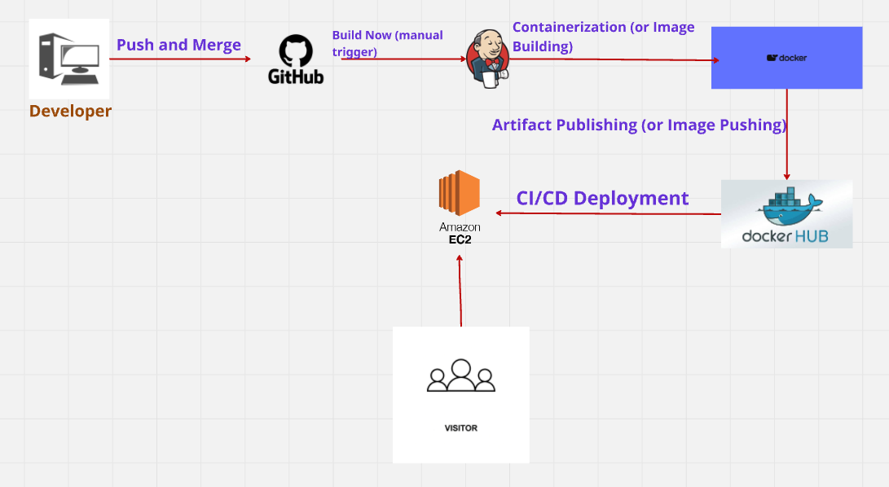

# 🐍 Snake Game


## 🎮 Features

- Classic Snake gameplay — arrow keys to move
- Live score tracking
- **Adjustable speed slider** — change game speed on the fly, even mid-game
- Game over screen with instant restart (press `Space`)
- Fully containerized — runs identically on any machine with Docker installed

---

## 🛠️ Tech Stack

| Layer | Technology |
|---|---|
| Backend | Python + Flask |
| Frontend | HTML5 Canvas + JavaScript |
| Containerization | Docker |
| Image registry | Docker Hub |
| CI/CD | Jenkins (declarative pipeline, running in WSL Ubuntu) |
| Hosting | AWS EC2 (Ubuntu) with an Elastic IP |
| HTTPS / reverse proxy | Caddy (automatic Let's Encrypt certificate) |
| Domain | DuckDNS (free subdomain) |

---

## 🏗️ Architecture

Flask serves a single HTML page containing embedded JavaScript. Once the page loads in the browser, **all game logic runs client-side** — movement, collision detection, scoring, and speed control are handled entirely by JavaScript in the browser's engine. Docker's only job is to package and serve the app consistently across environments.

```
Browser (JavaScript game loop) <- HTTP <- Flask (Python) <- Docker container
```

---

## 🔄 CI/CD Pipeline



1. **Push and merge:** code is pushed to GitHub.
2. **Build Now:** the Jenkins job `snake-pipeline` is started manually (no webhook, because Jenkins runs on a local machine that GitHub cannot reach).
3. **Containerization:** Jenkins builds the Docker image.
4. **Image pushing:** the image is pushed to Docker Hub as `anoncat01/docker-snake-game`, tagged with the build number and `latest`.
5. **Deployment:** Jenkins connects to the AWS EC2 server over SSH. The server pulls the new image and replaces the running `snake` container.
6. **Visitors** open the HTTPS link. Caddy receives the request and forwards it to the game container.

### Pipeline stages (`Jenkinsfile`)

| Stage | What it does |
|---|---|
| Checkout | Downloads the code from GitHub |
| Build Image | `docker build`, tagged with the build number and `latest` |
| Test | `python -m py_compile app.py` inside the new image to catch syntax errors |
| Push to Docker Hub | Logs in with Jenkins credentials and pushes both tags |
| Deploy to AWS | SSH to EC2, pull the image, replace the `snake` container |
| Smoke test | `curl --fail` on the live link, so the build fails if the site is down |

---

## ☁️ Deployment Setup (one time)

**AWS EC2**
- Ubuntu instance with Docker installed and an Elastic IP attached
- Security group: SSH (22) from my own IPv4 address only, HTTP (80) and HTTPS (443) from anywhere

**Server containers**
```bash
docker network create web
docker run -d --name caddy --network web --restart unless-stopped \
  -p 80:80 -p 443:443 \
  -v $HOME/caddy/Caddyfile:/etc/caddy/Caddyfile -v caddy_data:/data caddy:2
```
The `Caddyfile` contains `myownsnake-game.duckdns.org { reverse_proxy snake:5000 }`. The game container is started by Jenkins on the same `web` network and publishes no port of its own, so it is reachable only through Caddy.

**Jenkins**
- Plugins: Docker Pipeline, SSH Agent
- Credentials: `dockerhub-creds` (Docker Hub username and access token) and `ec2-ssh` (SSH private key for the `ubuntu` user)
- Job: `snake-pipeline`, Pipeline script from SCM, branch `*/main`, script path `Jenkinsfile`

---

## 🧠 Lessons Learned

- A security group rule saved from "My IP" was an IPv6 range, so SSH over IPv4 timed out. Replacing it with a Custom IPv4 `/32` rule fixed it.
- Containers on a user-defined Docker network reach each other by name (`snake:5000`), which is how Caddy finds the game.
- A smoke test after deployment catches failures that a green build alone does not show.
- A Jenkinsfile with an unbalanced `{` fails before any stage runs.

---

## 🚀 Run Locally

### Prerequisites
- [Docker](https://www.docker.com/products/docker-desktop/) installed and running

### Build the image
```bash
docker build -t snake-game .
```

### Run the container
```bash
docker run -d --name snake -p 5000:5000 snake-game
```

### Play
Open your browser to:
```
http://localhost:5000
```

---

## 🎯 Controls

| Key | Action |
|---|---|
| Arrow keys | Move the snake |
| `Space` | Restart after game over |
| Speed slider | Adjust game speed live (40ms - 300ms per frame) |

---

## 📂 Project Structure

```
.
├── app.py             # Flask server + embedded game (HTML/CSS/JS)
├── requirements.txt   # Python dependencies
├── Dockerfile         # Container build instructions
├── Jenkinsfile        # CI/CD pipeline (build, test, push, deploy, smoke test)
├── docs/
│   └── pipeline.png   # CI/CD flow diagram
└── .gitignore
```

---

## 📄 License

This project is open source and available for anyone to use or build upon.
